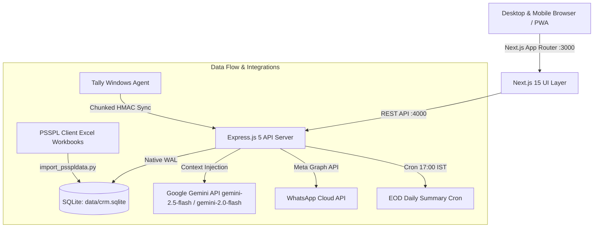

# PSSPL CRM System Architecture & Technical Specifications

This document outlines the complete technical architecture of the PSSPL CRM, spanning frontend client applications, Express API services, SQLite database schema, accounting synchronisation, and external automations.

---

## 1. High-Level Architecture



---

## 2. Technology Stack

* **Frontend Framework:** Next.js 15.5 (React 19, TypeScript 5.9) with App Router.
* **Styling & Presentation:** Vanilla CSS Design Tokens, high-contrast Report Card container borders (`1.5px solid #cbd5e1`), custom follow-up description box styles (`.followup-textarea` with `1.5px solid #0284c7` border & focus ring + `.followup-notes-display` left accent container), media query print stylesheet (`print.css`), and global header AI bar (`.topbar-ai-search`).
* **Modal Overlay & Executive Formatting:** React `createPortal` (`document.body`) for `AskAi` overlays + `AiResponseFormatter` component for parsing LLM Markdown into structured **Executive Insight Cards** with data point badges, action boxes, and metric pills.
* **Integrated Search Controls & Voice STT:** `<VoiceMicButton>` component integrated on all search inputs with dual-engine Speech-to-Text (browser Web Speech API for free instant transcription + backend OpenAI Whisper API `POST /api/stt` endpoint in `server/stt.mjs`).
* **Backend Runtime:** Node.js native ES Modules (`server/app.mjs`), Express 5.1.
* **Authentication Security:** Asynchronous non-blocking `crypto.scrypt` password verification (`promisify`), malformed hash guards, strict `Bearer` token validation, and background session cleanup.
* **AI Engine:** Google Gemini API (`gemini-2.5-flash`, `gemini-2.0-flash`, `gemini-1.5-flash`, `gemini-1.5-pro`, `gemini-3.6-flash`) via `GEMINI_API_KEY` with live SQL context window synthesis (`server/ai-context.mjs`).
* **Scheduler & Automation:** `node-cron` running daily at 5:00 PM IST (EOD WhatsApp digest).
* **Media & Voice Recording:** HTML5 `MediaRecorder` API + Web Speech API + `multer` backend audio storage and OpenAI Whisper `whisper-1` transcription.

---

## 3. Database Schema Overview

All application state resides in `data/crm.sqlite` across three primary domains:

### A. Authentication & User Management
* `users`: `id`, `email`, `password_hash` (`scrypt`), `role` (`admin` | `rm` | `salesperson`), `active`, `created_at`.
* `salesperson_profiles`: `user_id`, `employee_code`, `full_name`, `region`, `territory`, `manager_user_id`, `monthly_target`.
* `sessions`: Sliding window session tokens with idle timeout and maximum lifetime ceiling.
* `audit_logs`: Entity-level audit logging of admin actions, resets, and report exports.

### B. Field Mobility & Commercial Pipeline
* `attendance`: Daily GPS check-in and check-out with coordinates and timestamps.
* `visits`: Scheduled, in-progress, and completed dealer visits with purpose, outcomes, notes, `visit_tags`, `voice_note_path`, and `priority` (`high`, `medium`, `low`).
* `leads`: Kanban pipeline stages (`lead`, `technical_discussion`, `sample`, `quotation`, `follow_up`, `expected_order`, `won`, `lost`).
* `service_requests`: Customer complaints, technical trial evaluations, and quotation support tickets.
* `expected_orders`: Order pipeline tracking with expected amounts, dates, and statuses.
* `follow_ups`: Scheduled action items with due dates, priority levels (`high`, `medium`, `low`), channel mode (`follow_up_type`: `'call'` | `'visit'`), discussion notes (`notes`), and assignment (`assigned_to_user_id`).

### C. Tally Accounting Snapshots
* `tally_customers`: Master list of 171 dealers/customers with city, RM assignment, outstanding ledger balance, and last payment date.
* `tally_customer_monthly_sales`: 14-month historical monthly billing matrix.
* `tally_products`: Master catalog of 666 products with packing sizes, UOM, and unit prices.
* `tally_product_monthly_sales`: Monthly product movement quantities and sales values.
* `tally_rm_product_sales`: 1,896 product performance comparisons across all 12 Regional Managers.
* `tally_rm_targets`: Monthly sales targets in Lakhs for all RMs.
* `tally_invoices` & `tally_invoice_lines`: 868 real invoices and 1,730 product line items representing Rs 35.47 Cr in billing.

---

## 4. Portals & Security Model

```
+-----------------------------------------------------------------+
|                       PSSPL CRM Security                        |
+-----------------------------------------------------------------+
| Admin Role:       Full system visibility, user administration,  |
|                   approvals, connectors, and report exports.    |
|                                                                 |
| RM Role:          Scoped to team members and regional dealers   |
|                   matching `manager_user_id` or `rm_name`.      |
|                                                                 |
| Salesperson Role: Scoped to self-assigned visits, leads, day    |
|                   planner, and customer master catalog.         |
+-----------------------------------------------------------------+
```

### Route Structure
* `/admin/*`: Admin dashboard, quotation approvals, user directory, management reports, Tally sync.
* `/admin/team/[id]`: RM Sales Activity & Performance Drill-down Dashboard (7-tab breakdown of visits, pipeline, actual sales, products, follow-ups, and AI insights).
* `/rm/*`: RM home, team accountability, regional customer 360, product comparisons, overdue alerts.
* `/sales/*` & `/field`: Salesperson Day-Planner, GPS check-in, visit execution, voice note recording, Kanban pipeline.

### API Services
* `GET /api/admin/team`: Aggregates team performance, sales values, targets, and unassigned sales across all Regional Managers for the selected Financial Year.
* `GET /api/admin/team/:id`: Fetches detailed RM sales activity metrics, visits log, expected order pipeline, actual Tally invoices, product movement ranking, and open follow-ups. Uses subquery matching `c.rm_name IN (allNames)` and `v.user_id` to attribute field operations and invoices across all team customers and sales representatives.
* `POST /api/stt`: Receives recorded speech audio blobs (`multipart/form-data`) and transcribes speech to text using OpenAI Whisper API (`whisper-1`).

---

## 5. Automation & Integration Pipelines

### 1. Daily 5:00 PM EOD Summary Cron
Located in `server/app.mjs`:
* Triggers every day at 17:00 (`0 17 * * *`).
* Queries day attendance, completed visits, expected order bookings, and pending collections.
* Formats a clean WhatsApp markdown message and dispatches it via `server/whatsapp.mjs`.

### 2. Live Database AI Context & Response Formatting (`server/ai-context.mjs` & `AiResponseFormatter`)
* Dynamically synthesizes live database tables (`tally_invoices`, `tally_products`, `tally_customers`, `leads`, `follow_ups`, `salesperson_profiles`).
* Formats response via `AiResponseFormatter` into visual executive cards, metric pill badges, and data point callouts.
* Features integrated gradient search button and instant chip execution.
* Automatic model failover across `gemini-2.5-flash`, `gemini-2.0-flash`, `gemini-1.5-flash`, `gemini-1.5-pro`, and `gemini-3.6-flash`.

### 3. Excel Workbook Importer (`scripts/import_psspldata.py`)
* Automatically parses workbooks from client workbooks:
  - `6) Dealer Summary Apr, 2023 to May, 2024.xlsx`
  - `8) PSS Product Analysis I 2022-23 (005).xlsx`
  - `10) COMPARISON OF PRODUCT WITH QTY.xlsx`
  - `9) PSS Sales Incentive Calculations-24-25.xlsx`
  - `2) All Party wise Payments.xlsx`
* Generates synchronized user accounts, product lines, and real invoices for immediate operational testing.
